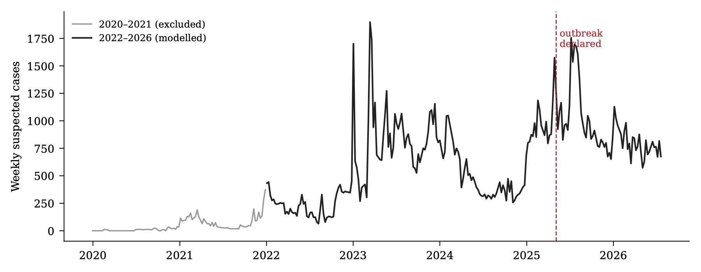
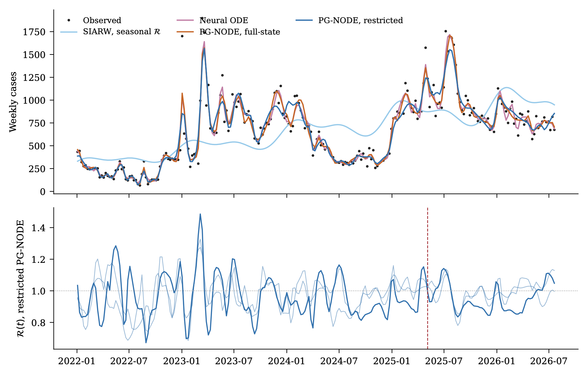
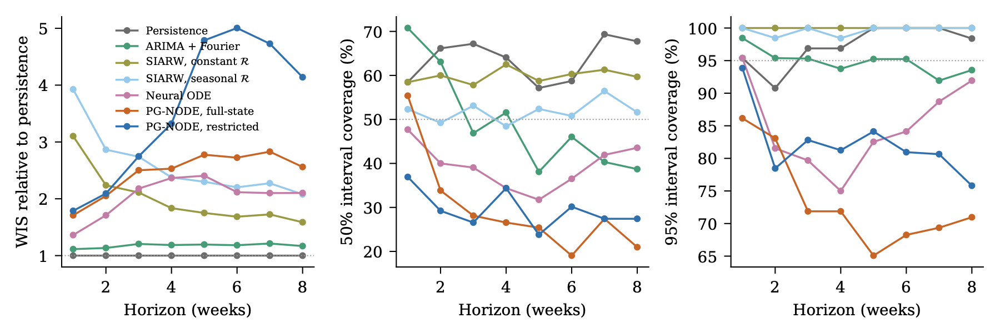
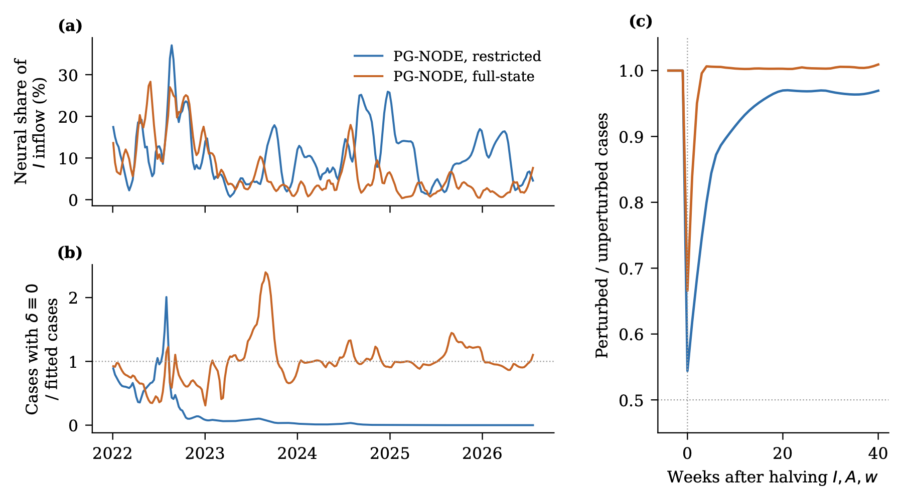
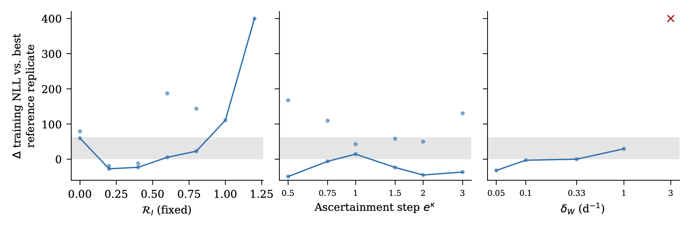
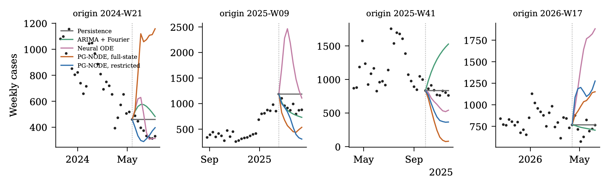

# PG-NODE for Cholera

**Coupling Compartmental Dynamics and Neural Networks under Imperfect Reporting: Cholera Forecasting from Routine Surveillance in the DRC**

Selain K. Kasereka, Mahmoud Hamed, Eric M. Mafuta, Kyandoghere Kyamakya

Code and figures for the paper (manuscript in preparation). The repository
contains the model, training, evaluation and figure-generation code. It does
**not** contain the surveillance data (see [Data](#data)).

---

## What the study does

We train a physics-guided neural ODE (PG-NODE) end-to-end on 238 weeks
(2022-W01 to 2026-W30) of national weekly suspected-cholera counts from
SNIS, the DHIS2 surveillance platform of the Democratic Republic of the
Congo. To our knowledge it is the first training of a PG-NODE on real data;
the original framework ([Kasereka et al., 2026, *Procedia Computer Science* 290](https://doi.org/10.1016/j.procs.2026.08.386))
was demonstrated on simulated trajectories only.

- **Mechanistic skeleton:** SIARW, with susceptible, symptomatic and
  asymptomatic infectious, recovered, and environmental *Vibrio cholerae*
  compartments, and both direct and waterborne transmission.
- **Neural terms:** a time-varying environmental transmission rate and a
  mass-conserving correction. Their inputs are either *restricted* to
  time and season or include the *full state*.
- **Observation model:** negative binomial.
- **Evaluation:** probabilistic forecasts 1–8 weeks ahead from 67 rolling
  origins, scored with the weighted interval score (WIS) and interval
  coverage. Comparators are persistence, ARIMA with Fourier terms,
  constant- and seasonal-R SIARW models, and an unconstrained neural ODE.
- **Analyses:** ablations of the neural terms and profile likelihoods for
  the transmission split, environmental persistence and an ascertainment
  step at the outbreak declaration (5 May 2025).

## Main results

- **Forecasting.** The PG-NODE trained stably and fitted the data far better
  than fixed-parameter models, but it did **not** forecast better.
  Persistence had the lowest WIS. Relative to persistence, ARIMA scored
  1.18, the constant-R SIARW 1.90, the neural ODE 2.10, the full-state
  PG-NODE 2.53 and the restricted PG-NODE 3.83.
- **What the neural terms learn.** With full-state inputs, the network
  undid an imposed halving of the infectious state within a few weeks,
  overriding the mechanism. With restricted inputs, the correction term
  acted as a source of infections that sustained the fitted epidemic.
- **Identifiability.** National counts identify neither the split between
  direct and waterborne transmission nor an ascertainment change at the
  outbreak declaration. Fits that differ only in random initialisation
  differ by up to 63 log-likelihood units, so profiles are read against
  that noise band.

| | |
|---|---|
|  |  |
|  |  |
|  |  |

`figures/` holds the published figures (PDF for print, PNG for display).

## Repository layout

```
code/
  pgnode.py         data loader, batched SIARW / PG-NODE models, NB likelihood, training
  describe.py       data checks, comparison with published totals, Figure 1
  forecast.py       rolling-origin fits (one batch per model class)
  fit_full.py       full-window fits, ablations, sensitivity and profile likelihoods
  score.py          persistence and ARIMA baselines, WIS / coverage scoring
  make_outputs.py   every table, figure and in-text number of the paper
  style.py          figure style
  requirements.txt
figures/            figures of the paper
```

## Data

The surveillance data belong to the Ministry of Public Health of the DRC and
are not distributed here. To run the code, place the weekly national series at
`data/vintage_2026-W30.csv`, in this format (one column per year, ISO weeks as
rows, empty cells for weeks not yet reported):

```
Week,2020,2021,2022,2023,2024,2025,2026
W1,...,...
...
W53,...
```

Access requests should be addressed to the Ministry (SNIS / PNECHOL-MD).
`data/` and `results/` are git-ignored.

## Reproducing the analysis

Python 3.13.

```bash
pip install -r code/requirements.txt
cd code
export OMP_NUM_THREADS=1            # one core per process when running in parallel

python describe.py                  # data checks
for k in const seasonal node pg_f pg_r; do
  python forecast.py $k &           # rolling-origin fits (67 origins per batch)
  python fit_full.py train $k &     # full-window fits, sensitivity, profiles
done; wait
python fit_full.py analyse          # ablations and profiles
python score.py                     # baselines and scoring
python make_outputs.py              # tables, figures (paper/figures/) and numbers
```

Re-running the pipeline writes the figures to `paper/figures/` and the tables and
in-text numbers to `paper/generated/`; the copies published in `figures/` are
those of the manuscript.

On one CPU core per process, the slowest job (full-state PG-NODE, rolling
origin) took about 5 hours. Each batch element is an independent fit with its
own parameters and training window. Gradient clipping and the recovery from
non-finite losses are applied per element, so one origin never influences
another.

## Citation

If you use this code, please cite this repository (see `CITATION.cff`, or
"Cite this repository" on GitHub) and the PG-NODE framework it builds on:

> Kasereka, S.K., Mafuta, E.M., Al Machot, F., Kabengele, E.M., Chedjou, J.C.,
> Kyamakya, K. (2026). PG-NODE<sup>TB</sup>: Physics-Guided Neural Ordinary
> Differential Equations for Tuberculosis Transmission Dynamics. *Procedia
> Computer Science* 290, 208–217. https://doi.org/10.1016/j.procs.2026.08.386

The paper describing the present study is in preparation.

## Licence

Code: [MIT](LICENSE). The surveillance data are not covered by this licence
and are not distributed.
